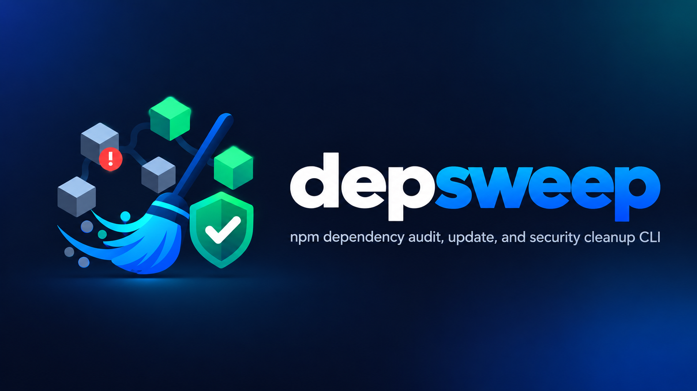

# depsweep
<p align="center">
  
</p>

[](https://github.com/bobbybacklogs/depsweep)
[](https://github.com/bobbybacklogs/depsweep/blob/main/LICENSE)
[](https://github.com/bobbybacklogs/depsweep/actions/workflows/npm-publish.yml)
[](https://www.npmjs.com/package/@genoventures-labs/depsweep)

---

# Overview
depsweep is a CLI tool that scans individual projects or entire directory trees for outdated and vulnerable npm dependencies, then helps you update packages and fix security issues in one sweep.
In a world where vulnerable dependencies can compromise security and stability, depsweep ensures your projects remain up-to-date and secure with minimal effort.

# Features

- Scan individual projects or entire directory trees for outdated npm dependencies.
- Detect and report vulnerable packages.
- Automatically update dependencies to the latest secure versions.
- Fix security issues with minimal manual intervention.
- Generate comprehensive reports on dependency status and security vulnerabilities.
- Support for both local and global npm packages.
- Agent-friendly CLI interface for seamless integration into development workflows.
- Detailed logging and reporting for better visibility into dependency management.

# Installation

To install depsweep, use npm:

```bash
npm install -g @genoventures-labs/depsweep
```

# Usage

After installation, you can use depsweep via the command line:

```bash
depsweep [options] <command>
```

For example, to scan a project for outdated dependencies:

```bash
depsweep scan
```

To update dependencies to the latest secure versions:

```bash
depsweep update
```

To fix security issues:

```bash
depsweep fix
```

# Commands

depsweep provides several commands to manage your dependencies:

- `scan`: Scan a project for outdated and vulnerable dependencies.
- `update`: Update dependencies to the latest secure versions.
- `fix`: Fix security issues in your project.
- `report`: Generate a comprehensive report on dependency status and security vulnerabilities.
- `help`: Display help information for depsweep commands and options.

# Options

depsweep supports several command-line options to customize its behavior:

- `-h, --help`: Show help information.
- `-v, --version`: Display the current version of depsweep.
- `-d, --directory <path>`: Specify the directory to scan or update.
- `-g, --global`: Include global npm packages in the scan or update.
- `-q, --quiet`: Suppress non-essential output.
- `-l, --log <file>`: Specify a file to write detailed logs.
- `-c, --config <file>`: Specify a custom configuration file for depsweep.
- `-f, --force`: Force update or fix actions even if no vulnerabilities are detected.
- `-s, --silent`: Run depsweep in silent mode, suppressing all output except for errors.
- `-r, --report <file>`: Specify a file to write the dependency and security report.
- `-e, --exclude <packages>`: Exclude specific packages from being scanned or updated.
- `-t, --threshold <level>`: Set the vulnerability severity threshold for reporting (e.g., low, moderate, high, critical).
- `-p, --package-manager <manager>`: Specify the package manager to use (e.g., npm, yarn).
- `-b, --backup`: Create a backup of the current dependency state before making changes.
- `-n, --no-color`: Disable colored output in the terminal.
- `-u, --update-lockfile`: Update the lockfile after making changes to dependencies.
